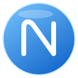
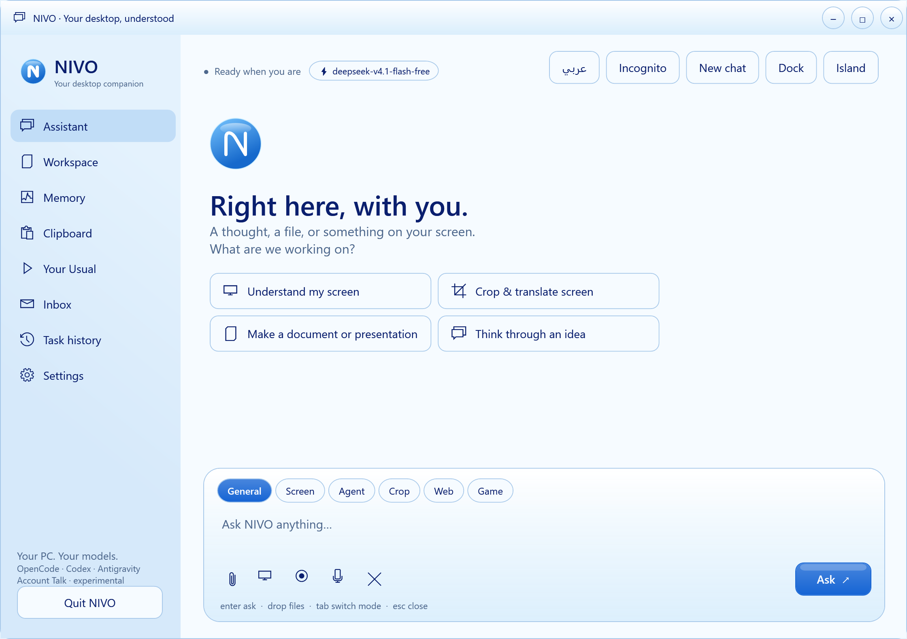
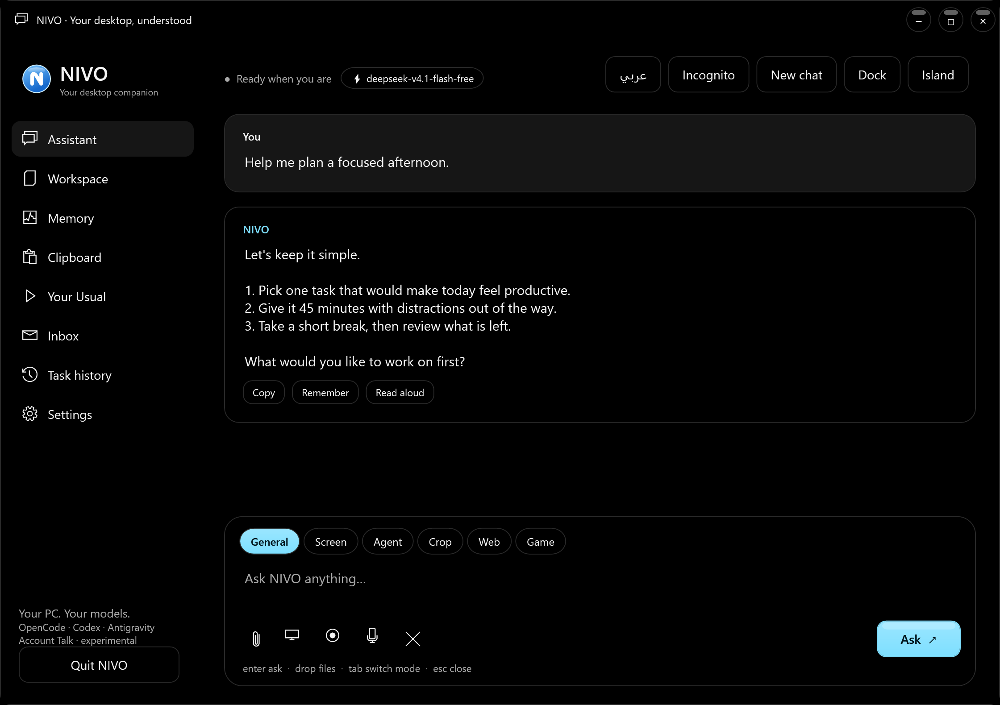
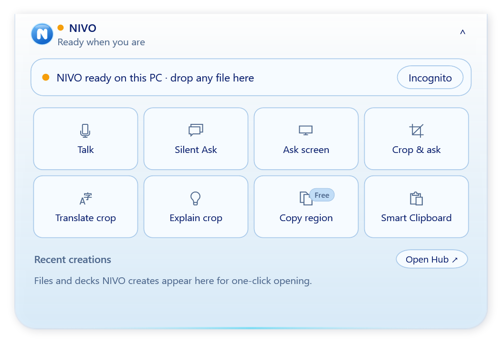
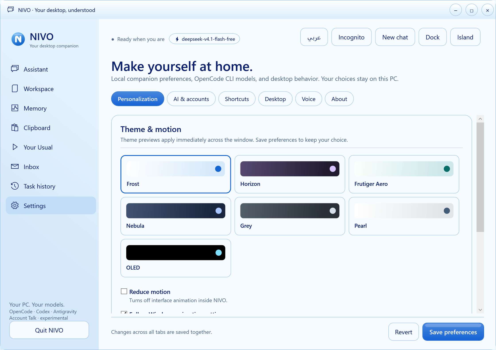
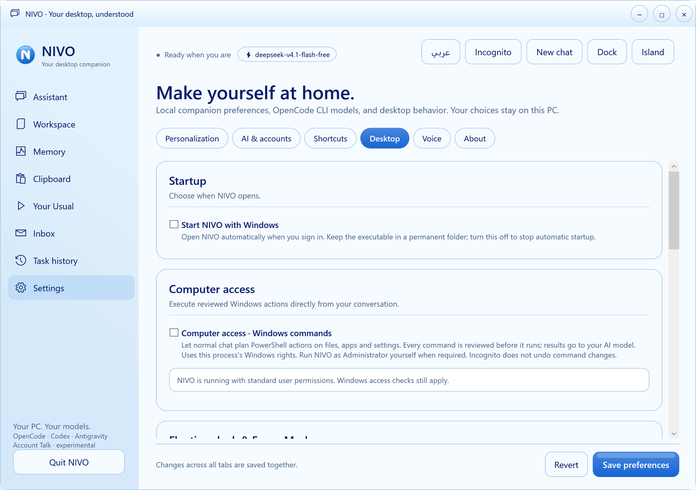

  

<h1 align="center">NIVO</h1>

Your Windows desktop, with a companion. A floating dock, a smart island, and AI help for everyday tasks.

  <a href="https://github.com/Ziadtareks/NIVO/releases/latest/download/NIVO.exe"><strong>Download for Windows</strong></a>
  &nbsp; · &nbsp;
  <a href="https://github.com/Ziadtareks/NIVO/releases/latest">Latest release</a>

One EXE · No build tools · .NET included · English &amp; Arabic

## Meet your desktop companion

Keep your apps close, ask about what's on your screen, and turn ideas into documents without leaving your desktop.

- **A calmer desktop.** Animated dock, focus profiles, seven themes, and OLED black. Hides during fullscreen apps and recognized games.
- **Help in context.** AI chat, screen questions, clipboard summaries, translations, and rewrites.
- **Your choice of AI.** OpenCode models, connected Codex/ChatGPT and Antigravity/Google accounts, and optional speech APIs.
- **Everyday work.** Local memory, routines, document creation, and PDF-to-Word conversion. Optional video and Office conversions use compatible installed tools.
- **You stay in control.** Review proposed Windows commands before they run.

## Take a look

<table>
  <tr>
    <td width="50%" valign="top">
      <strong>OLED black</strong> A pure-black theme for your conversations.  
      
    </td>
    <td width="50%" valign="top">
      <strong>The island</strong> Talk, screen questions, and clipboard actions in reach.  
      
    </td>
  </tr>
  <tr>
    <td width="50%" valign="top">
      <strong>Make it yours</strong> Choose a theme and adjust motion to your taste.  
      
    </td>
    <td width="50%" valign="top">
      <strong>Ready when Windows starts</strong> Turn automatic startup on or off in Settings.  
      
    </td>
  </tr>
</table>

Current app interface, shown with sample data.

## Get started

1. **[Download NIVO.exe](https://github.com/Ziadtareks/NIVO/releases/latest/download/NIVO.exe)** and keep it in a permanent folder.
2. Double-click to open it. No build tools or separate .NET installation needed.
3. Open **Settings → AI & accounts** to connect your provider.

Requires **Windows 10 version 2004 or newer, or Windows 11, 64-bit**. AI features use a supported installed provider runtime and your account. Provider access and quotas apply.

**Start with Windows:** open **Settings → Desktop**, enable **Start NIVO with Windows**, and save. No Administrator access needed. If you move the EXE, turn the option off and save, then enable it again to update its location.

**Voice:** Talk uses the available connected account. Codex voice is experimental. Antigravity opens its native window—press **F6** there to begin. Press Talk again to stop.

## Your data, your choices

History and account profiles stay under `%LOCALAPPDATA%\NIVO.Local`. Prompts and captures go to your selected provider. Computer actions require plan review; stopping them does not undo completed changes.

NIVO is an independent project inspired by AYO's public features. Live voice and physical desktop behavior are still being tested. [Features](docs/FEATURES.md) · [Known limits](docs/VERIFICATION.md) · [Third-party notices](docs/THIRD_PARTY.md)

## License

NIVO is licensed under the [MIT License](LICENSE).
